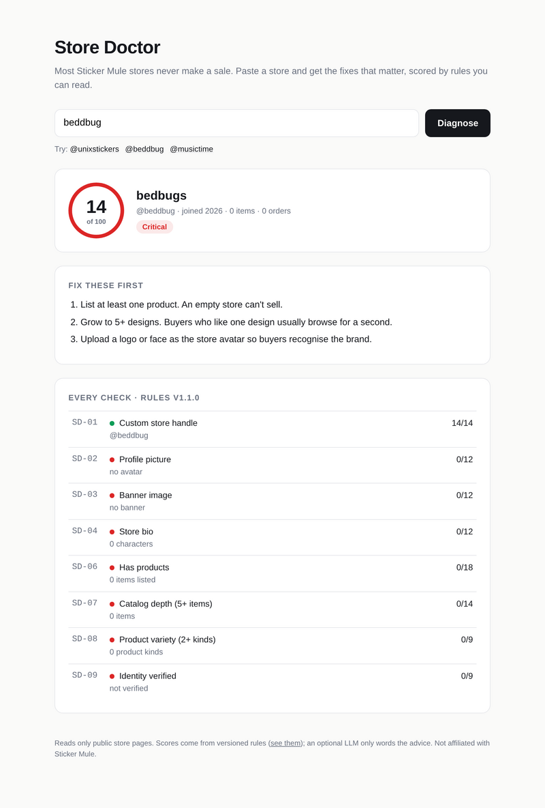
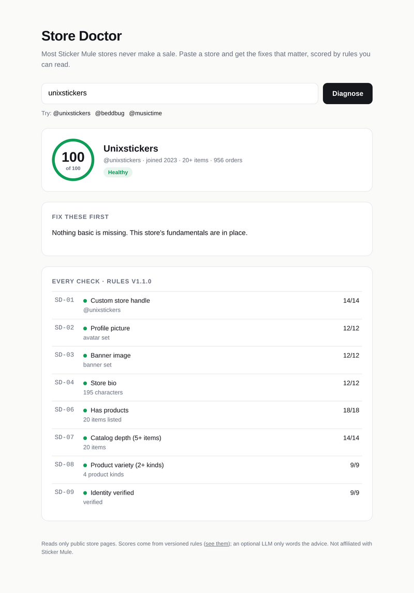

# Store Doctor

Sticker Mule hosts about 51,000 seller stores, and most of them have never made a sale. Store Doctor reads a store's public page, scores it with readable rules, and returns the three fixes worth the most points.

The score comes from code. An LLM can phrase advice for a specific store, but it receives the finished report and cannot change the number.

<p>
  
  
</p>

## Does the score mean anything?

I tested it against real outcomes. Sticker Mule's public leaderboard ranks every store by orders, down to stores with none. The eval samples 60 stores with 5+ orders and 60 with zero orders, scores each from its page alone, and measures separation.

| Rules | AUC, all stores | AUC, stores with ≥1 item | Mean score: sellers vs zero-sale |
|---|---|---|---|
| v1.0 (10 rules) | 0.918 | 0.874 | 82.3 vs 45.5 |
| **v1.1 (8 rules)** | **0.917** | **0.874** | **79.2 vs 36.5** |

AUC is the chance that a random seller outscores a random zero-sale store (0.5 = coin flip). The second column excludes empty stores, which make up 42% of the zero-sale sample and are the easy cases.

**The eval removed two rules.** In v1.0, "display name set" and "store is public" passed for 100% of sellers *and* 100% of zero-sale stores. They gave dead stores 14 free points and carried no signal, so v1.1 drops them. Separation is unchanged and the gap between the groups widens from 37 to 43 points. Per-rule pass rates are in [`eval/results-v1.0.json`](eval/results-v1.0.json).

Strongest signals (pass rate, sellers vs zero-sale): 5+ items 83% vs 12%, 2+ product kinds 85% vs 27%, identity verified 73% vs 22%, banner image 67% vs 17%.

**What this does not show:** causation. Sellers may verify or add banners *because* they sell. The next step would be an outcome test: track stores that apply a fix and compare their order growth with stores that don't. Postgres already keeps every diagnosis with a timestamp for that.

## How it works

```
GET /api/diagnose?store=@handle
  └─ sm.Fetch        public store page → Snapshot (from the server-rendered Apollo cache)
  └─ rules.Evaluate  8 rules, IDs SD-01..SD-09, points sum to 100 → score, grade, top fixes
  └─ advisor         optional Gemini call: failed rules in, plain-text advice out
  └─ db.Save         Postgres: every diagnosis, for score history
```

- **Go 1.23**, standard library HTTP (`net/http` routing), `pgx` for Postgres, single static binary.
- **Polite by default:** one request at a time with a minimum 700 ms gap, a named User-Agent, and a 10-minute response cache. It only reads what a logged-out visitor sees.
- **Rules are data you can read:** `GET /api/rules`, or [`internal/rules/rules.go`](internal/rules/rules.go). Each rule has an ID, its points, the check, and the fix text.

## Run it

```bash
go run ./cmd/server                       # http://localhost:8080
DATABASE_URL=postgres://... go run ./cmd/server   # + score history
GEMINI_API_KEY=... go run ./cmd/server            # + tailored advice
```

Deploy to Cloud Run:

```bash
gcloud run deploy store-doctor --source . --region us-central1 --allow-unauthenticated \
  --set-env-vars DATABASE_URL=...,GEMINI_API_KEY=...
```

Reproduce the eval (about 4 minutes, ~240 polite requests):

```bash
go run ./cmd/eval -n 60 -seed 7 -out eval
python3 eval/rescore.py      # re-score the saved sample under v1.1, no requests
```

## Tests

`go test ./...` covers page parsing against a saved real store page, handle validation, the rules (points sum to 100, determinism, fix ordering), the HTTP endpoint and its cache, the AUC metric, and a check that LLM advice cannot change a score. With `TEST_DATABASE_URL` set, the Postgres store is tested too. CI runs everything against a Postgres 17 service and builds the Docker image.

## Limits

- The store page server-renders up to 20 items, so catalog size is capped at "20+".
- One eval run, 120 stores, one seed. Leaderboard rank cut-offs (5+ orders below rank 1,000, zero orders past rank 8,000) were probed on 2026-10-14 and will drift.
- The Gemini advisor is unit-tested against a fake server, not yet against the live API.
- Unofficial. Not affiliated with Sticker Mule.

Built by [Anirudh Nadipally](https://github.com/Anirudh-Nadipally).
